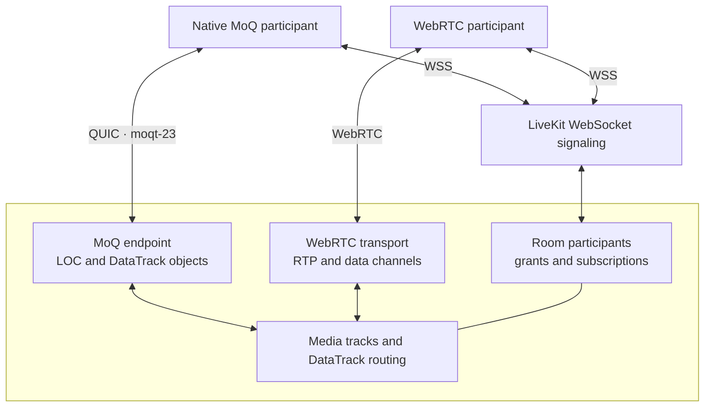
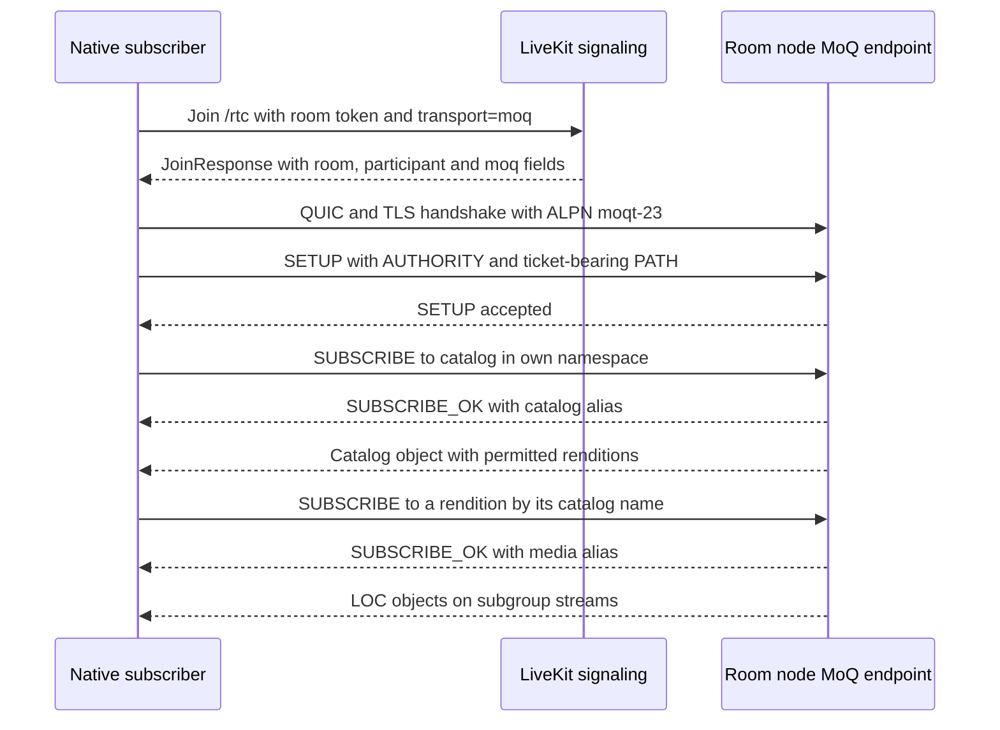

# Integrate native Media over QUIC with LiveKit

A participant can choose Media over QUIC (MoQ) when joining a LiveKit room. Video, audio and DataTrack frames travel over native QUIC. Room membership, permissions and track lifecycle use the existing LiveKit WebSocket. Other participants can join the same room over WebRTC. WebRTC is the default.

For a review of each server file involved in admission, media forwarding, DataTracks and interoperability testing, see the [SFU file-by-file changes](moq-file-changes.md).

For applications using the Rust SDK, the full 44-event comparison is in `livekit/docs/moq-feature-parity.md` in the matching SDK checkout. A visible MoQ viewer triggers the publisher's first-subscriber event when the SFU accepts its media subscription. A MoQ publisher can use this event to start capture. The viewer receives remote speaker and connection quality updates. For application data, publish a DataTrack. [MoQ media forwarding](../pkg/moq/media_track.go) · [WebRTC first-subscriber callback](../pkg/rtc/subscribedtrack.go)

## Enable the SFU endpoint

1. Use a server build that includes the MoQ endpoint and a client that supports the same wire profile. This source tree requires Go 1.27.4 and pins LiveKit protocol commit `a609e7a53312`. The matching Rust SDK pins the same schema in its `livekit-protocol/protocol` submodule. A source build needs access to that revision. [Server dependencies](../go.mod)
2. Add the following block to the SFU's existing YAML configuration. Replace the hostname and certificate paths with those for the room node. MoQ participants always have DataTracks enabled.

   ```yaml
   moq:
     enabled: true
     endpoint: moqt://node-1.example.com:7883/moq
   webtransport:
     port: 7883
     tls_cert_file: /etc/livekit/tls/fullchain.pem
     tls_key_file: /etc/livekit/tls/key.pem
   ```

3. Route **UDP** on the advertised port to this node's `webtransport.port`. Keep the existing signaling URL, for example `wss://signal.example.com`. The QUIC certificate must cover the advertised node hostname and chain to a CA trusted by the client. The endpoint URL requires an explicit port and the path `/moq`. The SFU supplies per-participant credentials at join time.
4. Start or restart the SFU with this configuration, for example `livekit-server --config livekit.yaml`. MoQ is disabled by default and the flag is read at startup. In a cluster, enable it on every node eligible to host these rooms. Signaling can enter through any node, but the advertised UDP endpoint must always lead to the **room owner**, including after a client's source IP changes. [Sample configuration](../config-sample.yaml)

## Connect from the Rust SDK

Enable the `moq` feature on the native `livekit` crate and select a WebSocket TLS feature for `wss://`. This command assumes the matching SDK checkout is at `../rust-sdks` relative to your app.

```sh
cargo add livekit --path ../rust-sdks/livekit --features moq,rustls-tls-native-roots
```

Pass the usual signaling URL and participant access token to `Room::connect`. The SDK obtains the node's MoQ address and attachment ticket during the join.

```rust
use livekit::prelude::{Room, RoomOptions, RoomTransport};

let mut options = RoomOptions::default();
options.transport = RoomTransport::Moq;
let (room, mut events) = Room::connect(signaling_url, participant_token, options).await?;
```

Use the usual `publish_track` API for a local video source. For data, publish a named DataTrack and push frames. On the receiving participant, handle `RoomEvent::DataTrackPublished(track)` and call `track.subscribe().await` to obtain its frame stream.

```rust
let telemetry = room.local_participant().publish_data_track("telemetry").await?;
telemetry.try_push(vec![1_u8, 2, 3].into())?;
```

For the Rust implementation, see `livekit/docs/moq.md` in the matching Rust SDK checkout. It traces the WebSocket join, QUIC attachment, native codec workers, DataTrack framing and network handoffs.

## How a mixed room forwards tracks

The boxed components run on the SFU that owns the room. Both participants use the same signaling service to control what they publish and receive.



The QUIC listener uses TLS ALPN to dispatch `moqt-23` to the MoQ endpoint and `h3` to its existing HTTP/3 handler. The MoQ endpoint attaches to the participant admitted over signaling. For MoQ → WebRTC, it packetizes encoded access units as RTP. For WebRTC → MoQ, it reassembles RTP into encoded access units. The codec stays the same, so the receiver needs a decoder for the publisher's codec. Both transports use the room's existing DataTrack routing and grants. [QUIC listener](../pkg/service/webtransport.go) · [MoQ endpoint](../pkg/moq/endpoint.go) · [Media bridge](../pkg/moq/media_track.go)

| Participant or capability | What interoperates |
| --- | --- |
| Native MoQ ↔ WebRTC and native MoQ ↔ native MoQ | Single-rendition H.264, H.265, VP8, VP9 and AV1 video, Opus audio and LiveKit DataTracks. Codec availability depends on the sender, receiver and room configuration. |
| Independent native MoQ subscriber | After LiveKit signaling, consume the standard MSF catalog and LOC media objects. The independent subscriber test discovers and receives a VP8 keyframe using standard catalog fields. |
| DataTrack applications | Track creation, handles, subscriptions and packet framing follow the LiveKit DataTrack protocol. A generic media decoder can consume the catalog's media tracks independently of these channels. |
| Outside this profile | Browser MoQ over WebTransport, room E2EE, multi-rendition selection, RPC, legacy data packets, text/byte streams, historical fetch and filtered or paused subscriptions. Browser participants can join through WebRTC. |

## Implement an independent media subscriber

The wire profile is `livekit-moq-2;moqt=23`. It uses native QUIC with TLS 1.3, MOQT draft 23 for transport, MSF draft 02 for the catalog and LOC draft 05 for media objects. Upgrade client and SFU together. Profile 2 requires QUIC DATAGRAM support. The SFU uses Trickster 2.2.2 over quic-go 0.64.1. The Rust SDK uses moqtap-client 0.16.0 and moqtap-codec 0.13.1 over Quinn 0.11.12. [MOQT](https://datatracker.ietf.org/doc/html/draft-ietf-moq-transport-23) · [MSF](https://datatracker.ietf.org/doc/html/draft-ietf-moq-msf-02) · [LOC](https://datatracker.ietf.org/doc/html/draft-ietf-moq-loc-05)



1. **Join the room.** Authenticate on the existing LiveKit `/rtc` WebSocket and add `transport=moq` to the usual join parameters. Keep signaling open. Use automatic subscription or signal the desired track SIDs. The SFU uses that interest and the participant's permissions to build the catalog.
2. **Attach QUIC.** Read `JoinResponse.moq`. Check the profile and that `participant_sid` matches the joining participant. Dial `endpoint` with ALPN `moqt-23`. For SETUP, set `AUTHORITY` to the advertised host and port. Set `PATH` to `/moq?room=<room.name>&sid=<participant_sid>&generation=<generation>&ticket=<attachment_token>`, URL-encoding each value. The ticket expires after 30 seconds and is consumed by a successful attachment. Treat the ticket and the assembled PATH as credentials. [Attachment validation](../pkg/rtc/participant_moq.go)
3. **Discover a rendition.** Use the two-element namespace `(namespace_prefix, participant_sid)`, for example `("livekit", "PA_reader")`. Use the **reader's own SID**, including when the publisher uses WebRTC. Subscribe to the track named `catalog`. Each object is a full JSON snapshot with `version: "draft-02"` and a `tracks` array. Select a track by `role` and `codec`. Catalog group IDs increase within the attachment. Video metadata describes spatial layer zero. Bitrate and frame rate are optional and can be absent until the SFU has a signaled bitrate or measured frame rate. Media entries carry `packaging: "loc"` and `packagingMetadata: "streamMapping=object"`. Optional `livekit.sid` and `livekit.publisherSid` fields associate the entry with signaling. [Catalog fields](../pkg/moq/media/catalog.go)
4. **Receive media.** Subscribe to the exact `name` from the catalog in that same namespace. Keep the request open. Route subgroup streams by the alias in the corresponding `SUBSCRIBE_OK`. Each downstream subgroup carries one object with one encoded video access unit or Opus packet. The SFU sends LOC timestamps in microseconds. For video, start at object zero of a keyframe group and resume at a decodable keyframe after a gap. [LOC properties](../pkg/moq/loc.go)

For example, if reader `PA_reader` receives the following entry in `tracks`, it subscribes to `TR_camera/vp8` in `("livekit", "PA_reader")`. The entry identifies `PA_camera` as the publisher.

```json
{
  "name": "TR_camera/vp8",
  "role": "video",
  "codec": "vp8",
  "isLive": true,
  "packaging": "loc",
  "packagingMetadata": "streamMapping=object",
  "livekit": { "sid": "TR_camera", "publisherSid": "PA_camera" }
}
```

### Publishing media and exchanging DataTracks

All names below use the joining participant's two-element namespace. Use a distinct client publication alias below 2³¹ for each upload and wait for `REQUEST_OK` before writing its objects.

| Operation | MoQ track | Signaling and framing |
| --- | --- | --- |
| Publish media | `PUBLISH up/<assigned-track-SID>/<codec>` | First send LiveKit `AddTrack` and use the SID from the publish response. Codec suffixes are `h264`, `h265`, `vp8`, `vp9`, `av1` and `opus`. Send each group on subgroup zero with consecutive object IDs starting at zero. Start a new group at each video keyframe or Opus packet. Include LOC timestamps and video frame markings. |
| Upload DataTracks | `PUBLISH dt/up/<SID>` | Use the SID from the WebSocket publish response. Each publication has its own alias. A group carries one serialized LiveKit packet. Send consecutive MOQT OBJECT_DATAGRAMs starting at object zero, with 1024 payload bytes per nonfinal object. Mark the final object END_OF_GROUP. |
| Receive DataTracks | `SUBSCRIBE dt/down/<SID>` | Subscribe through signaling first and use the SID from the subscriber handle map. Check the packet handle against the subscription. In both directions, reassemble chunks within each group and deliver complete packets immediately. Groups are independent. The limit is 64 objects per packet and the receive window is 16 groups per alias. |

QUIC datagrams have no stream ID. The MoQ alias identifies the DataTrack on the shared QUIC connection. The SDK retains a pending frame per publication, and the SFU queues outgoing packets per subscription. The SDK chooses the next pending frame by publisher priority. Lower numbers go first (0–255, default 128). Each chunk carries the frame’s priority. When the SFU chooses the next packet for a MoQ subscriber, it compares the MOQT subscriber priority first, the publisher priority second, and arrival order third. It uses the priority of object zero when reassembling a packet. WebRTC ingress supplies the default of 128. DataTracks share connection congestion control.

A Rust app can set the priority before publication or adjust it during a call. The setting is per local publication name and survives a room reconnect.

```rust
room.set_moq_data_track_priority("telemetry", 16);
room.set_moq_data_track_priority("thumbnails", 224);
```

## Network handoff and reconnect

When Wi-Fi switches to cellular, the native SDK checks the OS route to the connected SFU every 500 ms. If the source address changes, Quinn rebinds the existing endpoint and the SFU validates the new path. The same publications and subscriptions continue without another handshake or `PUBLISH`. Delivery can pause while the path recovers. The new network must reach the same SFU address before the session times out. WebSocket signaling can resume independently. A closed or expired attachment uses the normal reconnect and republish flow. [QUIC connection migration](https://www.rfc-editor.org/rfc/rfc9000.html#section-9)

## Verify a deployment

Join one participant over MoQ and one over WebRTC. Publish camera video and a named DataTrack in each direction. Confirm the receiver decodes video and receives the original DataTrack payload. The automated suite also exercises a native-only room and an independent subscriber. [Test commands and expected results](../test/moq/README.md)

| Symptom | First check |
| --- | --- |
| MoQ join returns HTTP 412 | Check `moq.enabled` on the node that owns the room and restart it after changing the flag. |
| WebSocket join succeeds but QUIC times out or TLS fails | Check the advertised hostname, external UDP port, routing to the owner, certificate chain and ALPN `moqt-23`. |
| SETUP returns `invalid room attachment` | Use a fresh ticket from signaling. Check the room name, participant SID, generation, URL encoding and destination node. |
| The catalog is empty or the track is unavailable | Check signaling subscription intent, grants, the reader's namespace, and the source track's codec and encryption. |
| Media works but DataTrack publication fails | Check the publisher's data grant. If publication succeeds but the receiver gets no data, check its subscription to the logical DataTrack. |
