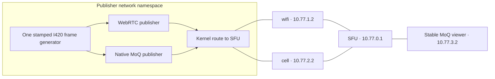

# Compare WebRTC and MoQ across a two-uplink handoff

This benchmark disconnects the publishers' active Linux network interface while both are streaming. The source continues capturing through the outage. A third participant on a stable link measures when each video becomes fresh again and which source frames it misses.

The November 24 measurements include a [two-second outage](results/2026-11-24/README.md) and a [zero-outage switch](results/2026-11-24/zero-outage/README.md). Both reports cover viewer recovery in both directions and include the underlying traces.

## Topology



Each line to the SFU represents an independent Linux veth pair in private network namespaces. The SFU uses the same service address throughout. The viewer decodes both tracks through the same MoQ downlink, including the SFU's WebRTC-to-MoQ bridge for the WebRTC publication. This measures application-visible video recovery for each publish path. The link names model two access networks. Both have local VM latency and bandwidth.

For a positive outage, the controller waits for both videos to advance, records the cut time, takes the active link down and removes its address. It checks that both publisher interfaces are down, the kernel cannot route to the SFU and a publisher ping fails. A simultaneous viewer ping must succeed. After the requested interval it activates the other interface, assigns its own address and installs the new default route. Both media and WebSocket signaling experience the kernel route loss. The SDK handles path changes and any reconnection on its own. The controller communicates with the media probes through the filesystem throughout the outage.

Packet captures at the SFU ends of all three links record IPv4 addresses, ports, lengths and timestamps. The snap length is 42 bytes. The test rejects a missing warm media path, usable publisher route during blackout, unexpected ingress path or interrupted viewer. A no-switch control runs the same capture and analysis with its original link kept up.

## Switch with zero configured outage

Use `--outage 0` to measure recovery when the replacement uplink already reaches the SFU. The controller brings up the standby interface, assigns its IP and verifies a round-trip ping to the SFU over that link. A dedicated routing rule admits the marked readiness ping while normal publisher traffic continues on the original default. At the cut marker the controller releases the standby source, replaces the Linux default route in one operation, and takes the old interface down. A valid default exists throughout. The no-switch control warms the same standby and keeps the original path active.

```sh
./test/moq/run_handoff_vm.sh /tmp/livekit-ready-handoff \
  --outage 0 --direction alternate --trials 10 --observe 8 --trace-quic
```

`probes.csv` records ICMP echoes from fresh sockets on the ordinary publisher route, targeting one probe every 2 ms around the switch. `network.json` records observed loss, the largest interval between replies, and the time from issuing the network commands to their acknowledgment. The interval between the cut and restoration markers in this mode measures command execution. It contains no scheduled outage. Each successive switched trial adds a different offset before the cut to sample the SDK's 500 ms route-monitor cycle.

For switched rooms, `first_new_udp_from_cut_ms` times the first upstream UDP packet at each transport port on the new link. With `--trace-quic`, `sfu_selected_path_from_cut_ms` times the SFU's logged QUIC path switch or WebRTC ICE pair selection. A blank value can also mean the corresponding event was not observed. Server log timestamps have millisecond precision. Packet captures and server logs carry wall time. The controller samples wall and monotonic time together in `clocks.csv` and converts those event times to the same monotonic clock as the frames. Events with an ambiguous clock conversion have an empty timing field. `fresh_after_cut_ms` requires a decoded frame captured after the network commands completed. At 30 fps, the phase of the next capture also contributes to that time. Frames captured while the kernel processes the switch appear under `route_change` in the frame and segment outputs. `longest_gap_through_capture_end_ms` includes later stalls through the end of capture.

## Build and run

Use a disposable Linux host or VM with `iproute2`, `iputils-ping`, `tcpdump`, OpenSSL and Python 3.9+. Namespace and interface creation require root inside that environment. The test creates uniquely named namespaces and cleans them up on exit. On macOS the two probes, SFU and controller all run inside the Linux guest. The Mac's Wi-Fi and default route stay available.

Build the SFU and the matching Rust SDK on Linux with the shared protocol revision and the SDK's native libwebrtc dependencies. Use a clang version compatible with the selected libwebrtc artifact. From the SFU checkout, with `SDK` pointing to the matching Rust checkout, run:

```sh
SFU=$PWD
SDK=../rust-sdks2
go build -o /tmp/lk-handoff-sfu ./cmd/server
PROBE=$(
  cd "$SDK" &&
  cargo test --locked -p livekit --features moq,__lk-e2e-test,rustls-tls-native-roots \
    --test moq_handoff_benchmark --no-run --message-format=json |
    python3 -c 'import json,sys; print(next(x["executable"] for x in map(json.loads,sys.stdin) if x.get("target",{}).get("name")=="moq_handoff_benchmark" and x.get("executable")))'
)
"$PROBE" --exact frame_id_and_timestamp_survive_watermark_readback
sudo python3 "$SFU/test/moq/handoff_compare.py" \
  --server-bin /tmp/lk-handoff-sfu --probe-bin "$PROBE" \
  --direction alternate --outage 2 --observe 35 --trials 4 --output /tmp/paired-video
```

The output directory must be new. The example runs one no-switch control followed by four independent switched rooms. Odd trials start on `wifi`, even trials start on `cell`. Set `--direction wifi-cell` or `cell-wifi` to repeat one direction. `--outage` controls the requested time from cut to activation in seconds. `--observe` controls capture duration after restoration. The controller also allows two seconds for the last frames to drain. A route and packet-capture smoke test can run before building either repository:

```sh
sudo python3 test/moq/handoff_compare.py --network-only --direction alternate \
  --trials 2 --outage 1 --output /tmp/paired-links
```

## Frame and timing measurements

Both publishers receive the same raw video frame with the same native timestamp, alternating which source receives it first. Each independently encodes VP8 at 640×360, 30 fps, one layer, with a 1.2 Mbit/s target. The pixels contain a 32-bit sequence number, a 32-bit capture time in microseconds relative to the source clock, a magic value and a CRC-16. The receiver reads this watermark from the decoded pixels and matches **both** the ID and time to the capture ledger. It timestamps delivery to the application before reading the watermark. All frame and cut timestamps use the same Linux CLOCK_MONOTONIC across processes. The controller records separate wall-clock markers for packet capture correlation. Reported latency includes encoding, the SFU, transport, decode and receiver scheduling.

| Measurement | Definition |
| --- | --- |
| First fresh frame | First advancing, valid frame captured after the new route was installed. Measured from both link cut and restoration. Queued outage frames arriving late cannot satisfy this metric. |
| First low-latency frame | First advancing frame captured after restoration and delivered within 250 ms of capture. This excludes stale catch-up video. |
| Longest gap through recovery | Longest interval between advancing frame IDs from the last pre-cut advance through the first fresh frame. A late frame can end a gap before fully fresh video returns. |
| Sustained recovery | First confirmation of at least 24 advancing fresh frames within a one-second window spanning at least 900 ms, all at most 250 ms old and with no interarrival gap over 150 ms. Includes the confirmation window. |
| Missing frames | Unique capture IDs never decoded by the end of the drain, grouped by **capture** time. Outage frames recovered from a buffer count as delivered. Per-phase latency exposes delayed delivery. |
| Baseline | Last two seconds before the cut marker. The no-switch control also reports the corresponding two-second marked interval with connectivity intact. |

`comparison.csv` has one row per publisher and trial. Each trial has `source.csv` (capture times and source acceptance), `decoded.csv` (every decoded sample), `frames.csv` (both first-arrival times and latencies for each ID), `publishers.csv` and `viewer.csv` (room events and track SIDs), `summary.json` (counts, percentiles and recovery times), and `network.json` (route, link, ping and packet evidence). The three header-only `.pcap` files permit independent inspection. Run `python3 test/moq/handoff_metrics.py /tmp/paired-video` to rebuild the summaries from the recorded ledgers. Missing recovery times are empty in CSV and null in JSON when the observation ends first.

## Rerun on a prepared macOS host

From the SFU checkout, the Lima launcher starts the prepared Linux guest, runs the test, copies the traces to a new directory on the Mac, and stops the guest if it started it. For example:

```sh
./test/moq/run_handoff_vm.sh /tmp/livekit-handoff-repeat \
  --direction alternate --trials 2 --outage 2 --observe 35
```

The prepared local installation uses `~/.local/share/livekit-handoff` for Lima and its guest. For an existing Lima setup, set `LIMACTL` to the CLI path, `LIMA_HOME` to the instance directory's parent and `HANDOFF_VM` to the guest name. Mount the SFU checkout at the same absolute path in the guest, install the Linux tools listed above, and install the two executables as `/opt/livekit-handoff/livekit-server` and `/opt/livekit-handoff/probe`. Rebuild and replace those executables when measuring a different revision of either repository.
