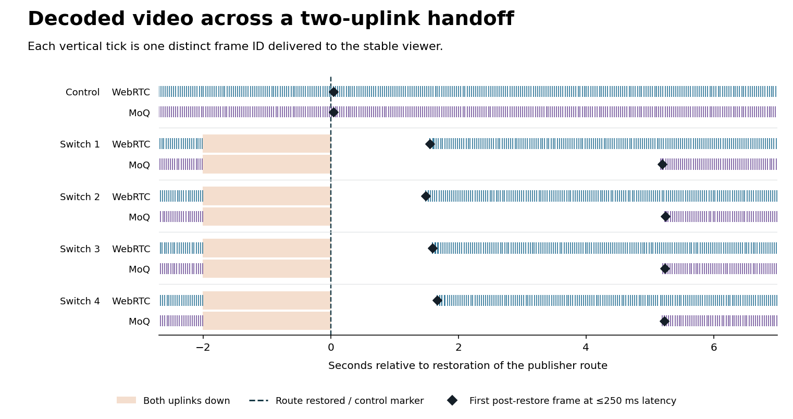

# Paired video uplink handoff on November 24, 2026

After a two-second loss of publisher connectivity, the viewer decoded the first frame captured on the restored path after a median **1.57 s for WebRTC** and **5.23 s for MoQ**. From the original link cut, the medians were **3.58 s** and **7.23 s**. Both publications recovered in every trial and kept their track SIDs.

The [zero-outage follow-up](zero-outage/README.md) measures the same publishers with the replacement link already connected and ready to reach the SFU.

## Four switched rooms and one control

Two publishers shared a deterministic 640×360, 30 fps video source, including the exact capture timestamp and visible frame ID. Both used VP8. A single stable MoQ viewer decoded both tracks. The experiment used two independently controllable virtual Ethernet links with different IP addresses in a local Ubuntu VM. Each switched trial brought the active interface down, verified that the publishers had no usable interface or route to the SFU, then brought up the other interface. The measured cut-to-restore intervals were 2.006–2.007 s. The original link stayed down for the rest of the trial.

| Trial | Direction | WebRTC first frame after restore | MoQ first frame after restore | Missed during outage, WebRTC / MoQ | Missed after restore, WebRTC / MoQ |
| --- | --- | ---: | ---: | ---: | ---: |
| Control | Wi-Fi link stays up | 38 ms | 38 ms | 0 / 0 of 60 | 0 / 0 of 1,051 |
| 1 | Wi-Fi → cellular | 1.552 s | 5.195 s | 60 / 59 of 60 | 44 / 152 of 1,052 |
| 2 | Cellular → Wi-Fi | 1.482 s | 5.239 s | 60 / 60 of 60 | 43 / 151 of 1,051 |
| 3 | Wi-Fi → cellular | 1.595 s | 5.232 s | 60 / 59 of 60 | 41 / 153 of 1,051 |
| 4 | Cellular → Wi-Fi | 1.662 s | 5.225 s | 60 / 59 of 60 | 45 / 154 of 1,051 |

A missed frame is a source ID the viewer never decoded by the end of the drain. The counts use when the frame was **captured**. WebRTC missed all 240 frames generated during the four outages. MoQ missed 237 and delivered three late. Across the first 35 seconds after restoration, WebRTC missed 173 of 4,205 frames and MoQ missed 610 of 4,205. Both source APIs accepted every frame captured during the outage and post-restore periods. All decoded watermarks passed validation, with zero duplicate or out-of-order IDs.

The longest gap in advancing decoded video was 3.49–3.67 s for WebRTC and 7.19–7.25 s for MoQ. In every trial, the first frame under 250 ms old arrived within 1 ms of the first post-restoration frame. Sustained video met the benchmark's one-second confirmation criterion 2.39–2.59 s after restoration for WebRTC and 6.11–6.16 s for MoQ. Per-trial p95 capture-to-decode latency among delivered post-restore frames was 5.79–7.10 ms and 6.12–6.86 ms, respectively. Those percentiles exclude missing frames.

## What the links and SDK reported

All four switched trials recorded an empty publisher route table lookup and a failed publisher ping during the outage. The viewer remained reachable on its separate link. SFU-side captures recorded the first publisher UDP traffic on the replacement link after 1.03–1.10 s at the RTC port and 1.63–1.82 s at the MoQ port. These packets can include connectivity checks or acknowledgments. The longer interval to a decoded MoQ frame remains unexplained by this measurement.

The publishers later emitted `Reconnecting` and `Reconnected` room events. Neither emitted `LocalTrackRepublished`. In all four runs the viewer resumed both original track subscriptions. The WebRTC-to-MoQ bridge is part of the observed WebRTC path. The local links model interface loss and a changed source address. They do not model radio acquisition, carrier latency, TURN, or Internet congestion.

## One-second interruption

A separate launcher check used a one-second break, a cellular-to-Wi-Fi switch and eight seconds of post-restore capture. WebRTC delivered its first post-restore frame in 0.69 s. MoQ delivered one in 0.93 s and reached a frame under 250 ms old at 2.13 s. This single switched trial and its own control are in the archive under `one-second-smoke/`. The table and timeline above use only the two-second experiment.

## Reproduce and inspect

The [harness guide](../../HANDOFF.md) includes the topology, build instructions, macOS launcher and timing definitions. The [comparison CSV](comparison.csv) contains both recovery measures and the per-trial timings. The [trace archive](traces.zip) contains source and receiver ledgers, per-frame latencies, SDK lifecycle events, link and route snapshots, header-only packet captures, and binary provenance. It includes the no-switch control and all four switched trials.
